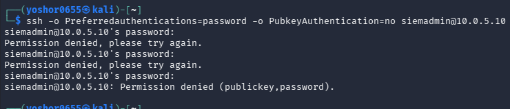
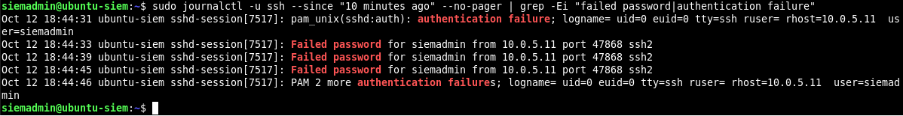
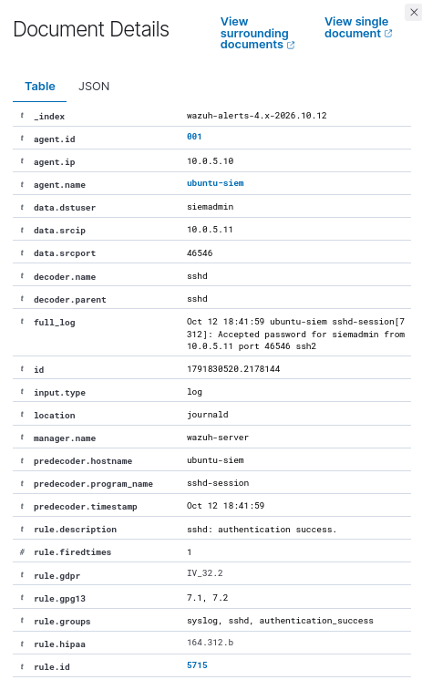
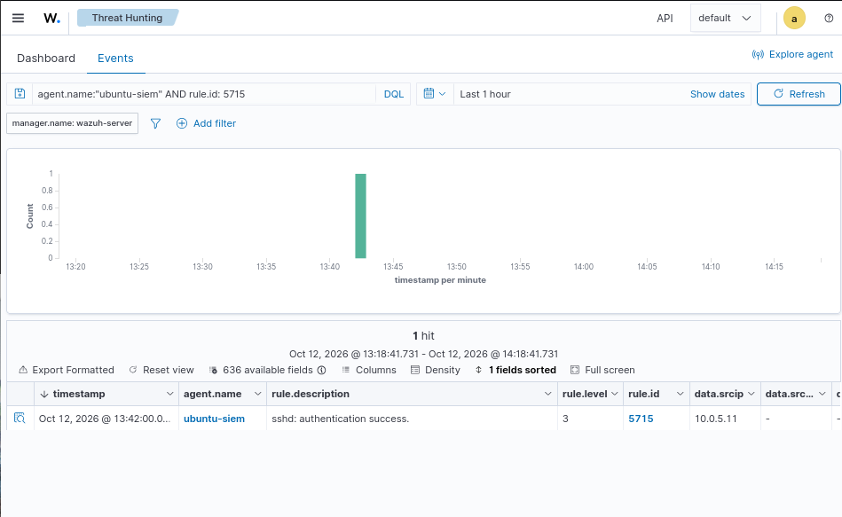
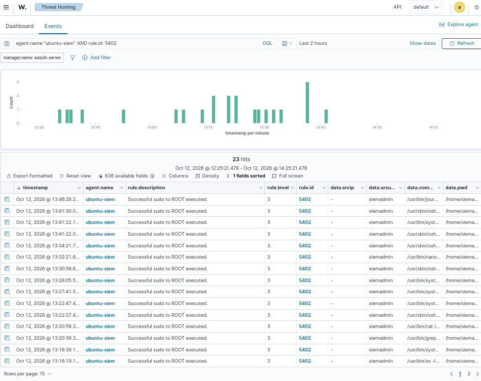
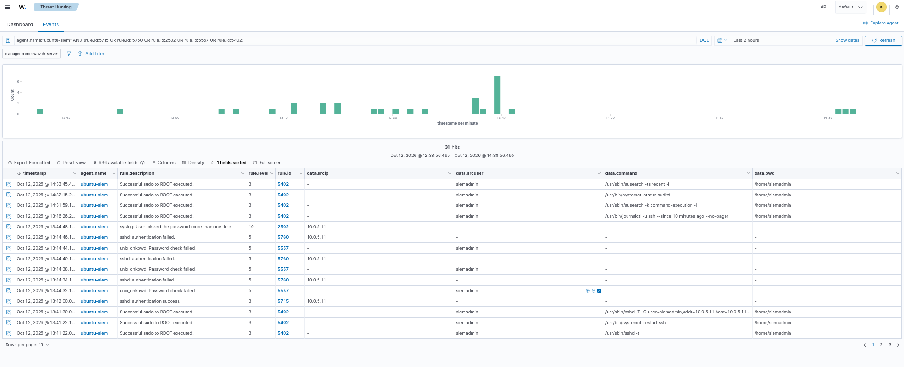

# Phase 6 — Security Incident Investigation and Analysis

## 1. Project Overview

This phase focuses on investigating suspicious SSH authentication activity using Wazuh SIEM in a virtual cybersecurity home lab.

Building on the previous phases, I performed a security investigation to identify failed and successful authentication attempts, analyze privileged command execution, reconstruct an incident timeline, and determine an appropriate incident response.

The objective was to develop practical Security Operations Center (SOC) analyst skills by applying an evidence-based investigation process.

## 2. Lab Environment

The investigation was conducted using three virtual machines configured in VirtualBox.

| Component | Description | IP Address |
|---|---|---|
| Kali Linux | Attack simulation machine | 10.0.5.11 |
| Ubuntu Linux | Monitored SSH server | 10.0.5.10 |
| Wazuh | SIEM monitoring and investigation platform | 10.0.5.14 |

**Additional components:**
- Wazuh Manager and endpoint agent
- Linux SSH service
- Linux systemd journal
- Auditd
- Sudo authentication and command logs
- pfSense virtual network gateway

**Target account:** `siemadmin`

All activities were performed within my authorized virtual lab environment.

## 3. Investigation Objectives

The primary objectives were to:

1. Identify suspicious SSH authentication activity.
2. Analyze failed and successful authentication attempts.
3. Examine source IP addresses, usernames, timestamps, and event details.
4. Investigate privileged commands executed through sudo.
5. Review auditd records for additional system activity.
6. Correlate multiple security events to reconstruct a timeline.
7. Determine whether the evidence supported unauthorized access or privilege escalation.
8. Classify the incident and recommend an appropriate response.

## 4. Initial SSH Authentication Investigation

I began by reviewing SSH authentication events collected by Wazuh from the Ubuntu endpoint.

The investigation focused on the account `siemadmin` and activity originating from the Kali Linux machine.

### 4.1 Failed SSH Authentication

Multiple failed authentication events were observed.

Relevant Wazuh detection rules included:

| Rule ID | Description |
|---|---|
| 5760 | SSH authentication failure |
| 5557 | Password verification failure |
| 2502 | Multiple password failures |

The events indicated unsuccessful authentication attempts against the Ubuntu SSH service.

A representative log message was:

`Failed password for siemadmin from 10.0.5.11 port 47868 ssh2`

**Analysis:**

The log identified the targeted username, originating IP address, temporary source port, and authentication outcome.

Repeated failures can indicate password guessing, but they can also occur when a legitimate user enters an incorrect password.

Therefore, these events were treated as suspicious indicators rather than definitive proof of an attack.

### 4.2 Wazuh Authentication Searches

I used Wazuh Threat Hunting to filter authentication-related events.

Example searches:

`agent.name:"ubuntu-siem"`

`rule.id:5760`

`rule.id:5557`

`rule.id:2502`

Some initial searches for other SSH-related rules, including rule 5710, returned no results.

I continued investigating with alternative rule identifiers and event details rather than assuming that the absence of one rule meant no authentication activity had occurred.

## 5. Successful SSH Authentication Investigation

During the investigation, I identified successful SSH authentication activity using Wazuh rule 5715.

**Detection details:**

| Field | Value |
|---|---|
| Rule ID | 5715 |
| Event | Successful SSH authentication |
| Username | siemadmin |
| Source IP | 10.0.5.11 |
| Destination | Ubuntu SSH server |
| Authentication method | Password |

A representative log message was:

`Accepted password for siemadmin from 10.0.5.11 port 46546 ssh2`

This confirmed that the account successfully authenticated to the Ubuntu SSH service.

**Important timeline finding:**

The successful SSH login appeared before the failed authentication attempts in the reviewed timeline.

Consequently, I could not conclude that repeated password guessing led to the successful login.

This demonstrated the importance of verifying event chronology before developing an incident hypothesis.

## 6. Privileged Activity Investigation

The next step was to determine whether the authentication activity was associated with elevated privileges or suspicious administrative commands.

### 6.1 Wazuh Sudo Events

I investigated Wazuh rule 5402, which recorded successful sudo command execution.

Search example:

`agent.name:"ubuntu-siem" AND rule.id:5402`

The investigation returned multiple sudo-related events.

Observed fields included:

| Field | Value |
|---|---|
| Rule ID | 5402 |
| Source user | siemadmin |
| Destination user | root |
| Working directory | /home/siemadmin |
| Terminal | /dev/pts/0 |

One observed command was:

`/usr/bin/journalctl -u ssh --since "10 minutes ago" --no-pager`

This command was used to review SSH service logs.

**Analysis:**

The evidence confirmed that `siemadmin` executed commands with root privileges through sudo.

However, successful sudo execution alone does not establish unauthorized privilege escalation.

The available events did not prove that the privileged commands were executed by an unauthorized user or originated from the suspicious SSH session.

### 6.2 Auditd Investigation

I also reviewed Linux audit records to investigate command execution and privileged system activity.

Commands used included:

`sudo ausearch -ts recent -i`

`sudo ausearch -k command_execution -i`

Auditd records included command execution information such as:

- User identity
- Effective user identity
- Executed command
- Executable path
- Audit event outcome

One observed audit event recorded execution of `ausearch` with root privileges.

This demonstrated that audit logging was collecting privileged command activity.

However, the reviewed audit records did not establish unauthorized root-shell access.

**Investigation conclusion:**

Privileged command execution was observed, but unauthorized privilege escalation was not confirmed.

## 7. Incident Timeline Reconstruction

To understand the relationship between authentication failures, successful logins, and sudo activity, I correlated multiple Wazuh rules.

Example combined search:

`agent.name:"ubuntu-siem" AND (rule.id:5715 OR rule.id:5760 OR rule.id:5557 OR rule.id:2502 OR rule.id:5402)`

The search allowed me to review multiple event categories within the same investigation period.

### Observed Timeline

| Approximate dashboard time | Event | Evidence |
|---|---|---|
| 13:42 | Successful SSH authentication | Rule 5715 |
| 13:44 | Failed SSH authentication attempts | Rules 5760, 5557, 2502 |
| Investigation period | Privileged sudo commands observed | Rule 5402 |

**Note:** The displayed dashboard timestamps and raw Linux log timestamps used different time representations. The timeline was evaluated using the selected Wazuh dashboard time range.

### Timeline Analysis

The investigation established that:

- Successful authentication occurred before the reviewed failed authentication attempts.
- The account involved was `siemadmin`.
- Authentication events originated from Kali Linux.
- Sudo command execution was observed on Ubuntu.
- The combined timeline alone did not establish that the sudo activity belonged to the SSH session from Kali.

Additional session correlation or process ancestry evidence would be needed to establish that relationship.

## 8. Investigation Evidence — Screenshots

The following screenshots document the investigation and provide supporting evidence for the findings.

### Evidence 1 — Failed SSH Authentication

**Description:**

Wazuh detected failed SSH authentication attempts involving the `siemadmin` account.

The screenshot demonstrates the identification of unsuccessful login attempts through Wazuh rule 5760.

### Evidence 2 — Authentication Event Details

**Description:**

Detailed authentication logs were reviewed to identify the source IP address, targeted account, source port, and authentication result.

This information helped establish the origin and nature of the activity.

### Evidence 3 — Successful SSH Authentication

**Description:**

Wazuh rule 5715 identified successful password authentication for `siemadmin`.

This evidence confirmed a successful SSH login but did not, by itself, establish unauthorized access.

### Evidence 4 — Privileged Sudo Activity

**Description:**

Wazuh rule 5402 recorded successful sudo command execution by `siemadmin`.

The observed administrative commands demonstrated privileged activity, but unauthorized escalation was not established.

### Evidence 5 — Incident Timeline

**Description:**

A combined Wazuh search correlated successful SSH authentication, failed authentication attempts, and sudo activity.

This evidence supported the reconstruction of the incident timeline and the assessment of event relationships.

### Evidence 6 — Auditd Investigation

**Description:**

Linux audit records were reviewed to examine command execution and privileged activity.

The available evidence did not establish unauthorized root-shell access.

## 9. Incident Classification and Severity Assessment

After analyzing the available evidence, I classified the incident as suspicious authentication activity.

| Category | Assessment |
|---|---|
| Incident ID | LAB-IR-006 |
| Incident type | Suspicious SSH authentication |
| Severity | Medium |
| Classification | Suspicious |
| Confirmed unauthorized access | No |
| Confirmed unauthorized privilege escalation | No |
| Recommended action | Further investigation |

### Severity Justification

Medium severity was selected because multiple authentication failures were observed alongside successful authentication and privileged command execution.

However, the investigation did not provide sufficient evidence to classify the activity as a confirmed compromise.

Possible explanations included legitimate user authentication errors, authorized administrative activity, or suspicious password-guessing behavior.

The available evidence did not establish which explanation accounted for every event.

## 10. Incident Response Decision

The recommended response was to continue investigating rather than immediately disable the account, permanently block the source IP, or close the incident.

### Recommended Actions

1. Verify the observed authentication activity with the legitimate account owner.
2. Review the source IP address and determine whether it corresponds to authorized activity.
3. Examine additional authentication logs and session identifiers.
4. Correlate privileged commands with the relevant login sessions.
5. Continue monitoring for additional failed authentication attempts or unexpected commands.
6. Escalate or contain the activity if additional evidence indicates unauthorized access or an active threat.

### Analyst Decision

The investigation demonstrated that containment decisions should be based on the available evidence and the potential impact of the activity.

Immediate containment may be appropriate when active unauthorized access is suspected, but unnecessary account restrictions can interrupt legitimate operations.

For this case, continued verification and monitoring were selected.

## 11. Final Analyst Assessment

The investigation identified suspicious SSH authentication activity involving the `siemadmin` account.

Multiple failed authentication attempts were recorded, and successful SSH authentication was confirmed.

Privileged sudo command execution was also observed.

However, the available evidence did not establish that the successful authentication was unauthorized or that the privileged commands originated from the suspicious SSH session.

The incident was therefore classified as **medium severity — suspicious activity**, with further investigation recommended.

The case was documented without claiming a confirmed compromise.

## 12. Skills Developed

Through this phase, I gained hands-on experience with:

- Security incident investigation
- Wazuh SIEM Threat Hunting
- SSH authentication log analysis
- Security event correlation
- Linux system log investigation
- Auditd command execution analysis
- Sudo activity analysis
- Incident timeline reconstruction
- Severity assessment and incident classification
- Evidence-based incident response
- SOC analyst documentation and reporting

## 13. Challenges and Lessons Learned

### Challenge 1 — Missing Wazuh Rule Results

Some searches returned no matching events.

**Lesson learned:** A missing detection rule does not necessarily mean the activity did not occur. Alternative rules, time ranges, and original log messages should be examined.

### Challenge 2 — Understanding Authentication Chronology

Successful SSH authentication was observed before the reviewed failures.

**Lesson learned:** Analysts must verify timestamps before concluding that a successful login resulted from password guessing.

### Challenge 3 — Distinguishing Sudo Activity From Compromise

Successful sudo events initially raised questions about privilege escalation.

**Lesson learned:** Authorized administrative commands and unauthorized privilege escalation are not equivalent. Additional context is required to establish malicious activity.

### Challenge 4 — Choosing an Appropriate Incident Response

The evidence supported suspicious activity but did not establish confirmed compromise.

**Lesson learned:** Incident response decisions should consider confidence, severity, business impact, and the risk of continued activity.

## 14. Conclusion

Phase 6 strengthened my understanding of how SOC analysts investigate security events and make evidence-based decisions.

Using Wazuh, Linux authentication logs, sudo events, and auditd records, I investigated suspicious SSH activity, reconstructed an incident timeline, and evaluated whether the available evidence supported a security compromise.

The most important lesson was that **suspicious activity is not automatically proof of compromise**.

A successful investigation requires accurate evidence collection, careful event correlation, clear documentation, and appropriate response recommendations.

This phase helped me move beyond identifying individual security alerts toward understanding the complete incident investigation process.

**Next Phase:** Advanced Threat Detection and Custom Wazuh Rules.
